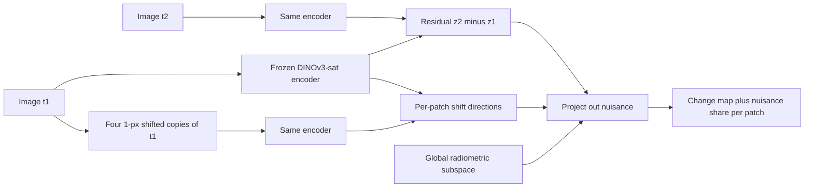

# NullShift — telling real change from instrument change, without retraining

**Biswarup Mukherjee** · MSc IPCVai (UAM Madrid / Univ. Bordeaux) · proposal draft, 25 September 2026
Compute budget: 1 × RTX 4000 (20 GB), 30–40 GB storage(should be much lesser, goal is to consume 20 % of that)

---

## 0. Short description (for emails and CV)

> Change-detection models flag a change whenever two acquisitions *look* different, including when nothing on the ground moved and only the instrument did: a sub-pixel misregistration, a gain or tone-curve difference between satellites, a haze layer. **NullShift** is a training-free operator that removes these acquisition effects from the feature residual of a frozen foundation model before the change decision. Radiometric effects are removed with a dataset-level nuisance subspace (following NFAD, 2026); geometric effects — which prior work leaves open — are removed with a *per-patch* subspace built from four shifted copies of the reference image. It is evaluated on *null pairs* (an image against a perturbed copy of itself, where every detected change is false by construction), reporting false-change rate as a function of nuisance strength.

---

## 1. Plain-language version

Two photos of the same street, taken a month apart. A change detector should light up only where something was built or demolished. In practice it also lights up along every building edge if the second photo is shifted by half a pixel, and across whole fields if the second satellite renders colours slightly differently. For a company selling *verified* measurements of change, those false alarms are the product failing.

The idea has three parts.

1. **Test honestly.** Take an image, apply a known nuisance to a copy of it (shift it 0.5 px, brighten it 10 %, add haze), and ask the detector to compare the two. Nothing changed, so every pixel it flags is a false alarm. Turn the nuisance up step by step and plot how fast false alarms grow. No labels needed.
2. **Remove brightness-type nuisance.** Push many images through the frozen network with and without such perturbations, record which directions in feature space move, and delete those directions from the before/after difference. This part is borrowed from a recent industrial-inspection paper (NFAD) and transferred to satellites.
3. **Remove shift-type nuisance — the new part.** A small shift changes features differently at every location (strongly on an edge, barely in a flat field), so one global set of directions cannot capture it. Instead, for each patch, shift the *reference* image by one pixel left/right/up/down, see which way that patch's features move, and delete exactly those two directions from that patch's difference. A misregistration then cancels to first order; a new building, which changes far more than two directions, survives.

No network is trained or fine-tuned. The operator is a few small matrix products per patch.

---

## 2. What already exists (every paper below was opened and checked BUT THERE MIGHT BE OTHER PAPERS OF INTEREST THAT CAN BE CHECKED)

| Paper | What it does | What it leaves open, relative to this proposal |
|---|---|---|
| **NFAD** — Cao et al., arXiv 2608.29112 (Aug 2026) | Industrial anomaly detection under acquisition shift. Estimates a nuisance subspace label-free from feature displacements under content-preserving perturbations ("matched intervention response"), removes it post-hoc from a frozen detector. 91.0 % image AUROC on AeBAD-S. Shows nuisance and defect are *entangled in direction* and separates them by *spatial incidence* (nuisance global, defect local). | Industrial images only. Photometric and background interventions only; the authors name geometric interventions as future work, and their *view* domain is their weakest. Assumes nuisance is spatially global — false for misregistration, which concentrates on edges. |
| **SCDistill** — Qu et al., arXiv 2607.19000 (Jul 2026) | RS semantic CD robust to illumination/shadow/atmosphere. Diffusion relighting + InstructPix2Pix weather edits on the pre-change image; self-distils a DINOv3 encoder to be invariant. SOTA on SECOND/HRSCD. | Training-heavy (FSC-180k pretraining, ~40 GPU-h reported). Generative perturbations are not physically parameterised, so no dose–response. No geometric nuisance. Reports accuracy only, no false-change rate. |
| **FAF-CD** — arXiv 2606.03114 (Jun 2026) | Frequency-aware fusion CD. Supplement runs a pseudo-change study: perturb one image (brightness/contrast, colour jitter, haze, shadow; severity 1–5), keep the other clean. | This is the "perturbed pair" arm already. No null pair with exact zero-change truth, no geometric nuisance, and results are averaged cIoU/cF1 rather than a false-change rate. |
| **SEED** — arXiv 2601.07805 (Jan 2026) | Parameter-free feature exchange replaces differencing; section on systematic pixel misregistration. | Trains *under* misregistration; explicitly not zero-shot aligned→misaligned. Global shifts only. |
| **FAR-Aware-Copula-CD** — Li et al., IEEE TIP 35:3865–3880 (2026) | CFAR-style control of false-alarm rate in heterogeneous CD via copula GLRT and adaptive thresholds. | Controls the *rate* by thresholding; does not attribute false alarms to physical nuisance factors or remove them. |
| **HyperLUCID** — Lin, …, Chanussot, arXiv 2608.06028 (Aug 2026) | Onboard, zero-label hyperspectral CD: learns a spectral calibration function from safely-unchanged pixels, then detects. | Same philosophy ("calibrate the nuisance away first") in pixel space and hyperspectral; no geometry. Useful related work for the onboard/Xoople angle. |
| **Trustworthy CD benchmark** — Tomanič et al., arXiv 2608.28247 (Aug 2026) | 10 architectures × 10 datasets, identical protocol, accuracy + efficiency. Siamese U-Nets competitive. Releases checkpoints. | No robustness or nuisance axis. Its checkpoints are a ready model zoo for the plug-in experiment. |
| **Systematic review** — Jabbarizadegan & Fraternali, Remote Sensing 18(15):2573 (2026) | PRISMA review of 144 studies. Finds architectural gains have saturated; recommends label-efficient methods and standardised protocols; names radiometric variability, co-registration error and sensor heterogeneity as core difficulties. | Motivates a training-free, protocol-level contribution rather than another architecture. |
| **Adversarial SCD** — Yu, Xu, Ghamisi, arXiv 2608.15267 (Aug 2026) | Norm-bounded adversarial attacks on semantic CD; perturbing one timestamp propagates to the other. | Adversarial, not physical nuisance. Adjacent evaluation methodology. |
| **SAAF** — Qian & Ma, arXiv 2609.28192 (Sep 2026) | Change captions as the only supervision for CD masks. | Supervision paradigm; not overlapping. |
| **Change3D** — CVPR 2025 · **JL1-CD** — arXiv 2502.13407 | Video-model CD/captioning; a new CD benchmark with multi-teacher distillation. | Architectures/benchmarks; no nuisance attribution. *(Verified via citations in the papers above, not opened directly.)* |
| **DiffRegCD** — arXiv 2511.07935 | Joint registration and CD with diffusion features. | Learned, trained registration. NullShift is the training-free alternative and should be compared against a registration baseline. |
| **CPEN** — Remote Sensing 18:2583 (2026) | Photometric enhancement for low-light CD; uses gamma simulation as stress test. | Photometric only; trained. |

**Also relevant, and used:** DINOv3 (Siméoni et al., 2025) releases a ViT-L/16 distilled on SAT-493M (493 M Maxar RGB tiles at 0.6 m), available through timm as `vit_large_patch16_dinov3.sat493m` (303 M parameters).

---

## 3. The gap, stated precisely

As far as I can find after reading the above:

- Nuisance-robust RS change detection exists, but it is **trained** (SCDistill, SEED, CPEN, FAF-CD). Nothing removes acquisition nuisance **post-hoc from a frozen model**.
- The one post-hoc nuisance-subspace method (NFAD) is **not in remote sensing**, handles **no geometric nuisance**, and relies on nuisance being **spatially global**.
- Perturbed-pair robustness tests exist (FAF-CD), but not **null pairs with exact zero-change truth**, not **geometric dose–response**, and not **false-change rate** as a separate metric.

The ingredients are not new — Lucas–Kanade-style first-order linearisation is 45 years old, and NFAD's intervention subspace is weeks old. The claim is that **combining them into a per-patch geometric nuisance subspace on foundation-model residuals, and testing it in RS change detection**, has not been done.

---

## 4. Objectives and falsifiable hypotheses

**O1 — Measure.** A null-pair protocol with six physically parameterised nuisance families and dose–response curves of false-change rate.
**O2 — Transfer.** NFAD's global subspace to bitemporal RS residuals for radiometric nuisance.
**O3 — Extend.** A per-patch geometric subspace from matched shift interventions.
**O4 — Understand.** Whether NFAD's "direction entangled, incidence separates" finding survives when the nuisance is local.

| # | Hypothesis | Kill criterion (stop or pivot if true) |
|---|---|---|
| H1 | For shifts ≤ 2 px, the first-order prediction `J·d` explains most of the actual feature displacement. | Relative error > 0.6 at 1 px. |
| H2 | The per-patch shift subspace captures most misregistration residual energy but little true-change energy. | Energy-removed ratio (nuisance / true change) ≈ 1. |
| H3 | On shifted null pairs, false-change rate falls substantially, while clean-pair F1 drops by ≤ 1 point. | Clean F1 drops by > 3 points. |
| H4 | On S2Looking (real off-nadir parallax), F1 rises or false changes fall with no retraining. | No gain on real data → the result is synthetic-only; report it as such. |
| H5 | NFAD's global subspace transfers to RS radiometric nuisance (gain, tone curve, haze, cross-sensor colour matrix). | No FCR reduction on radiometric null pairs. |
| H6 | NFAD's incidence gate *fails* for misregistration because it is edge-local. | If it works, the geometric extension is unnecessary — say so. |

H6 is a prediction I expect to hold, and it is the scientific finding that makes O3 necessary rather than decorative.

---

## 5. Method

Frozen encoder `f`. Patch features `z1 = f(I1)`, `z2 = f(I2)`, each `C × H' × W'` (C = 1024 for ViT-L). Residual per patch: `r(p) = z2(p) − z1(p)`.

**Geometric nuisance (new).** A displacement `d` of `I1` perturbs patch features, to first order, as
`f(shift(I1, d))(p) ≈ z1(p) + J(p) · d`, with `J(p) ∈ R^{C×2}`.
Estimate `J(p)` by central differences over four shifted copies of `I1` (±ε in x and in y). No analytical gradient of the network is needed, and it does not assume the ViT is translation-equivariant. Orthonormalise `Q(p) = orth(J(p))`; optionally stack `J` from `I2` too (rank ≤ 4). Project:
`r_geo(p) = r(p) − Q(p) Q(p)ᵀ r(p)`.
Cost: 4 extra forward passes of `I1` and a rank-2 projection per patch.

**Radiometric nuisance (transfer of NFAD).** Over a set of unlabeled images, apply content-preserving radiometric interventions (gain, gamma/tone curve, Rayleigh-weighted haze, 3 × 3 colour-mixing matrix as a cross-sensor proxy, JPEG), collect `Δz = f(T(x)) − f(x)`, keep the top-k eigenvectors of the uncentred second moment as `V`. Project globally: `r' = r_geo − V Vᵀ r_geo`.

**Outputs.** Change score `‖r'(p)‖`, and a per-patch **nuisance share** `1 − ‖r'(p)‖² / ‖r(p)‖²` — the fraction of apparent change the operator attributes to the instrument. That second map is the uncertainty-flavoured deliverable: it says *why* a pixel was downweighted.

**Two settings.**
- *Zero-shot:* score = `‖r'‖`, threshold chosen on clean validation.
- *Supervised plug-in:* a light head (or a Siamese U-Net) trained on clean LEVIR-CD; the operator is inserted at test time only. This is the "train clean, deploy on a shifted instrument" scenario.

---

## 6. Experiments

**Data.** LEVIR-CD (VHR building change, 637 pairs of 1024², Google Earth) as the primary set; S2Looking (off-nadir side-looking satellite pairs, real parallax) as the real-misregistration test; OSCD (Sentinel-2, ONERA) optional for a medium-resolution sanity check. Confirm exact sizes on download; all are expected to fit well inside 30 GB.

**Encoders.** DINOv3 ViT-L/16 SAT-493M (main), DINOv3 ViT-B/16 web, DINOv2-B with registers (to show backbone-agnosticism, as NFAD did).

| ID | Experiment | Answers |
|---|---|---|
| E1 | Linearity: compare `f(shift(I,d)) − f(I)` with `J·d` for d ∈ {0.25, 0.5, 1, 2, 4} px, sub-pixel shifts via Fourier phase ramp | H1 |
| E2 | Entanglement: fraction of energy removed on misregistration residuals vs on annotated change pixels; repeat NFAD's analysis for the global `V` | H2, H6 |
| E3 | Null-pair dose–response: FCR vs dose for six nuisance families, with/without each operator | H3, H5 |
| E4 | Perturbed-pair accuracy (FAF-CD-style arm): F1 on `(I1, T(I2))` at fixed threshold | H3 |
| E5 | Real misregistration: S2Looking, zero-shot and plug-in | H4 |
| E6 | Plug-in: operator inserted into a trained Siamese U-Net / checkpoint from the 2608.28247 model zoo | generality |

**Baselines — these could beat the method, so they must be in.**
1. Global phase-correlation registration before CD. For a *pure global* shift this should win outright; NullShift's case rests on *spatially varying* residual misregistration (parallax, relief), which global registration cannot fix. Test both.
2. Local-minimum matching over a 3 × 3 patch neighbourhood. Handles multi-patch shifts; cannot handle sub-patch shifts at 16-px patch size. Expected crossover — report it.
3. Gaussian pre-blur of both images.
4. Head trained with random-shift augmentation (the learned alternative).
5. NFAD-style global subspace alone, including its incidence gate.

**Metrics.** False-change rate on null pairs at a fixed threshold; F1/IoU on clean and perturbed pairs; energy-removal selectivity; wall-clock overhead.

**Spatially varying displacement.** Beyond global shifts, inject smooth random displacement fields and a height-proportional parallax proxy on building footprints (LEVIR masks give footprints), to mimic off-nadir relief.

---

## 7. Feasibility on the stated hardware

| Item | Estimate |
|---|---|
| Encoder | ViT-L/16, 303 M params, ~82 GMACs at 256² (timm model card). ~0.6 GB in fp16. |
| Forward passes | 6 per pair (t1, t2, four shifts of t1). LEVIR test set = 2 048 crops of 256² → ~12 k passes. Minutes on an RTX 4000. |
| Radiometric subspace | a few thousand intervention pairs once; minutes. |
| Training | none (zero-shot) · a few GPU-hours for the optional supervised head / Siamese U-Net. |
| VRAM | comfortably < 10 GB at batch 16. |
| Storage | datasets a few GB each + 1.2 GB weights; features computed on the fly, not cached per intervention. |
| People-time | ~8–10 weeks part-time alongside coursework. |

The DINOv3 licence applies to the SAT-493M weights; read it before redistributing anything derived.

---

## 8. Novelty — graded honestly

| Contribution | Novelty | Why |
|---|---|---|
| Null-pair protocol, FCR dose–response | **Low–moderate** | FAF-CD already does the perturbed-pair arm; the null arm, geometry and FCR metric are incremental additions. Useful, not a paper alone. |
| NFAD global subspace transferred to RS | **Moderate** | First RS use found, but a direct transfer. Reviewers will say so. |
| Per-patch geometric subspace from shift interventions | **Moderate–good** | Fills NFAD's stated gap with a principled, cheap, local construction. Classical ingredients, new combination. This is the headline. |
| H6 finding (incidence gating fails for local nuisance) | **Moderate** | A clean, explainable negative result about the method you build on is valuable if it holds. |

**Scoop risk.** NFAD's authors list geometric interventions as their next step. If this is worth doing, post a preprint early.

---

## 9. Paper chance

Conditional on E1–E3 passing:

- **IEEE GRSL letter, IGARSS 2027, CVPR EarthVision 2027 workshop** — realistic. A training-free operator with a clean dose–response figure and honest baselines is exactly the shape these venues accept.
- **IEEE TGRS / JSTARS** — possible if E5 (real S2Looking parallax) and E6 (plug-in into trained models) both show gains, across ≥ 2 backbones.
- **CVPR / ICCV main track** — unlikely. The likely review is "NFAD plus a Taylor expansion".

If E1 fails (features not locally linear in shift), the project still yields an analysis paper on geometric nuisance in foundation features, at workshop level. Check venue deadlines directly; they move each year.

---

## 10. Impact

- **Scientific.** Answers a question the NFAD paper opens but cannot test on its data: what happens when the nuisance is local. Aligns with the 2026 systematic review's conclusion that CD architectures have saturated and the field needs label-efficient methods and standardised protocols.
- **Operational.** A frozen model gains robustness to a new instrument with zero retraining — the situation when a new satellite joins a constellation or a new drone joins a survey fleet. The null-pair FCR gives a number an operator can put in a specification: *false-change rate ≤ x % for residual misregistration ≤ 0.5 px*.
- **Limits.** RGB, VHR-centric; parallax is approximated, not modelled from a DSM; it will not beat SOTA F1 on clean benchmarks and does not claim to.

---

## 11. Fit with the target companies

**Xoople — strong fit.** Their positioning (earlier verified) is verifiable time-series measurements of physical change from their own optical constellation. Topics from their industrial-day talk map directly: *constellation change detection* → the core problem; *tone mapping* and *raw data* → tone-curve, gain and colour-matrix interventions; *aleatoric/epistemic uncertainty* → the nuisance-share map and the null-pair FCR as a verifiability figure. It also continues the cloud-uncertainty notebook naturally: that one decided **which pixels are usable**; this one decides **which detected changes are real**.

**Geosat — medium fit, only with the right framing.** None of their three posted internships is change detection:
- *Vectorisation of linear elements in 3D urban point clouds (DAIA)* — no fit.
- *GPR subsurface analysis* — no fit.
- *Geospatial foundation models on Geosat data* — **good methodological fit.** It asks to study GeoFMs (OlmoEarth, Prithvi, SatMAE, SatCLIP, SAM variants), build an evaluation pipeline with metrics, and explore adaptation of models trained on coarse global imagery to Geosat's precise local data; temporal change is listed among GeoFM capabilities. NullShift is exactly "probe a frozen GeoFM's feature space with controlled interventions and measure what it is sensitive to".

Pitch to Geosat as **frozen-GeoFM evaluation and training-free adaptation**, not as change detection. A cheap Geosat-flavoured add-on: repeat E2–E3 on French aerial orthophotos (e.g., IGN FLAIR) to show how DINOv3-sat features react to inter-campaign colour, illumination and registration differences. Their R&D hub is in Canéjan (Gironde), reachable during the Bordeaux mobility.

---

## 12. Risks and fallbacks

| Risk | Fallback |
|---|---|
| ViT tokens not linear in sub-patch shift (E1) | Multi-scale shift basis (ε ∈ {0.5, 1, 2} px, rank 6); or apply the operator to an intermediate block with finer effective resolution. |
| True change removed along with misregistration at building edges (E2) | Gate by magnitude of the residual orthogonal to `J`; report the trade-off curve rather than one point. |
| Global registration beats it everywhere | Restrict the claim to spatially varying displacement, which is where it should win; if it doesn't, publish the analysis. |
| Synthetic gains don't transfer to S2Looking | Report honestly; the protocol and analysis still stand at workshop level. |
| Scooped by NFAD follow-up | Early arXiv; RS-specific evaluation remains distinct. |

---

## 13. Timeline (part-time)

| Weeks | Work |
|---|---|
| 1–2 | Data, encoders, null-pair generator, E1 linearity. **Go/no-go on H1.** |
| 3–4 | E2 entanglement, E3 dose–response, baselines 1–3. **Go/no-go on H2.** |
| 5–6 | Radiometric subspace (O2), spatially varying displacement, E4. |
| 7–8 | E5 S2Looking, E6 plug-in, second backbone. |
| 9–10 | Write-up, figures, code release, arXiv. |

---

## References

- Cao, Nghiem, Nguyen, Rekimoto, Wu. *NFAD: Nuisance-Filtered Anomaly Detection Under Distribution Shift.* arXiv:2608.29112, 2026.
- Qu, Liang, Fu. *Learning Semantic-Robust Change Detection via Semantic-Invariant Self-Distillation.* arXiv:2607.19000, 2026.
- *FAF-CD: Frequency-Aware Fusion for Change Detection under Imperfect Multimodal Remote Sensing.* arXiv:2606.03114, 2026.
- *Exchange Is All You Need for Remote Sensing Change Detection (SEED).* arXiv:2601.07805, 2026.
- Li, Zhang, Wang, Li, Varshney. *Unsupervised False-Alarm-Controllable Change Detection in Heterogeneous Remote Sensing Images Based on Copula Theory.* IEEE TIP 35:3865–3880, 2026. doi:10.1109/TIP.2026.3678762
- Lin, Hsu, Liang, Chanussot, Chen. *Hyperspectral Calibration Detection … (HyperLUCID).* arXiv:2608.06028, 2026.
- Tomanič et al. *A comprehensive and trustworthy benchmark of AI methods for change detection in Earth observation.* arXiv:2608.28247, 2026.
- Jabbarizadegan, Fraternali. *Change Detection in Remote Sensing Imagery: A Systematic Review of Statistical, Machine Learning, and Deep Learning Methods.* Remote Sensing 18(15):2573, 2026. doi:10.3390/rs18152573
- Yu, Xu, Ghamisi. *On the Adversarial Robustness of Remote Sensing Semantic Change Detection.* arXiv:2608.15267, 2026.
- Qian, Ma. *From Change Captions to Change Detection: Semantic-Appearance Agreement Framework.* arXiv:2609.28192, 2026.
- Zhu et al. *Change3D.* CVPR 2025, pp. 24011–24022. · Liu et al. *JL1-CD.* arXiv:2502.13407, 2025.
- *DiffRegCD: Integrated Registration and Change Detection with Diffusion Features.* arXiv:2511.07935.
- *Consistent Photometric Enhancement Network for Remote Sensing Change Detection.* Remote Sensing 18:2583, 2026.
- Siméoni et al. *DINOv3.* arXiv:2508.10104, 2025.
- Chen & Shi. *LEVIR-CD.* Remote Sensing 12, 2020. · Shen et al. *S2Looking.* Remote Sensing 13(24):5094, 2021. · Daudt et al. *OSCD.* IGARSS 2018.
- Lucas & Kanade. *An iterative image registration technique with an application to stereo vision.* IJCAI 1981.
