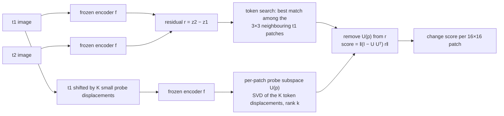
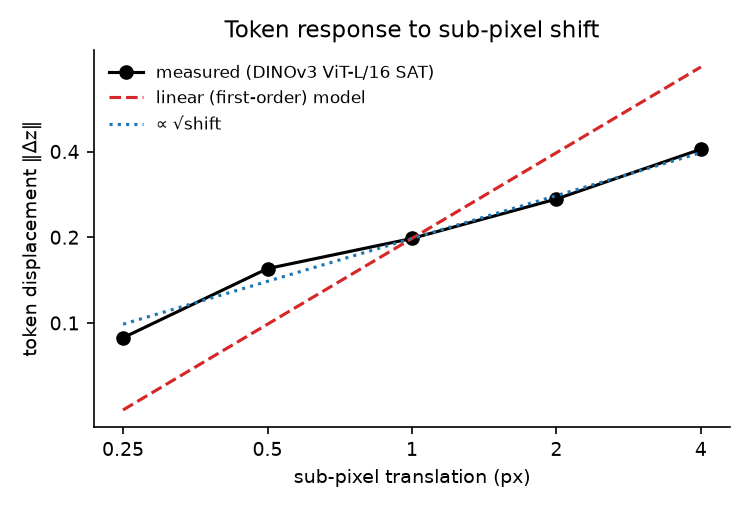
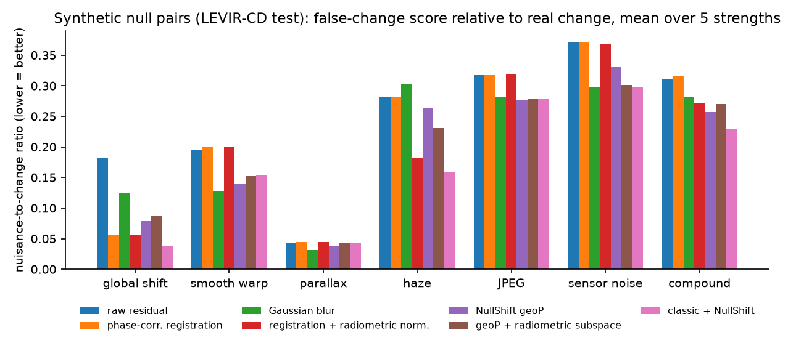
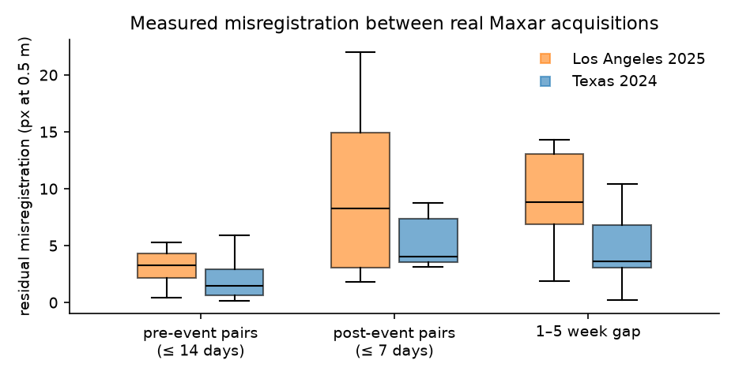
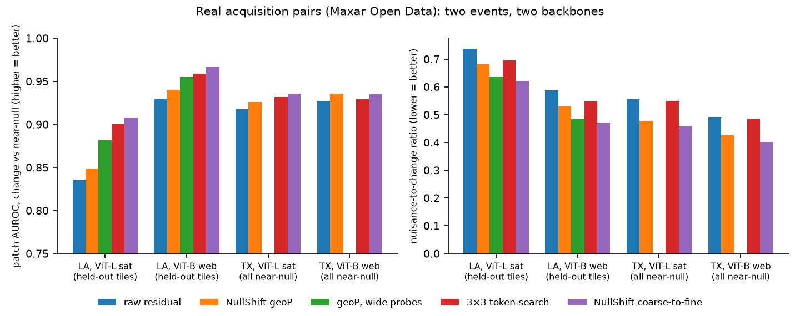

# NullShift: separating real change from acquisition change in frozen satellite foundation models

Change detection on very-high-resolution (VHR) satellite imagery raises false alarms when **nothing changed on the
ground** and only the acquisition did: the two images are misregistered by a few pixels, buildings lean differently
because the satellite looked from another angle, or the sensors render colour, noise and compression differently.

NullShift is a **training-free** operator that removes these acquisition effects from the feature difference of a
**frozen** foundation model (DINOv3) before the change decision. It needs no labels and no fine-tuning. The nuisance
directions are estimated at test time from the reference image itself.

**Main result.** On real Maxar acquisition pairs (Los Angeles 2025, held-out tiles), the coarse-to-fine operator raises
patch AUROC (real destruction vs. near-identical re-acquisitions) from **0.835 to 0.908** on DINOv3 ViT-L/16-SAT and
from **0.930 to 0.967** on DINOv3 ViT-B/16. It also cuts the nuisance-to-change ratio by 16–20 %. Against the strongest
simple baseline (3×3 feature-neighbourhood search) the gain is small but significant on both backbones, and it is
partly replicated on a second event (Texas 2024) whose design was fixed before that data was built.

---

## 1. Problem

A common training-free change score compares the patch tokens of the two images,
$s(p) = \lVert z_2(p) - z_1(p) \rVert$, where $z = f(\text{image})$ is a frozen encoder.

Any difference between the two images moves $z$, including ones that have nothing to do with the ground:

| nuisance | physical cause | typical size in VHR pairs |
|---|---|---|
| misregistration | orthorectification residuals, DEM errors | **3–22 px at 0.5 m** (measured here, §4.3) |
| parallax | different off-nadir angle, building lean | several px on tall buildings |
| radiometry | sensor, sun, haze, tone curve, JPEG, noise | sensor-dependent |

The question is whether these acquisition-induced components can be removed from the residual
$r = z_2 - z_1$ **without** removing real change and **without** training a new model for every sensor combination.

## 2. Method



**Per-patch probe subspace (`geoP`).**
1. The reference image $t_1$ is shifted by $K$ small known displacements (8 directions × several magnitudes) and
   re-encoded.
2. For every patch, the $K$ token displacements span the directions in which *that patch's* token moves under
   misregistration; the top-$k$ singular vectors form $U(p)$.
3. The score is the norm of the residual after projecting out $U(p)$.

The subspace is built from the patch's own content at test time, so a road edge and a roof get different nuisance
directions. A real change (a destroyed house) moves the token in many directions outside $U(p)$ and survives the
projection.

**Coarse-to-fine (`c2f`).** Real misregistration is several pixels (measured, §4.3), beyond what small probes cover.
1. Each $t_2$ patch is matched to the most similar of the 3×3 neighbouring $t_1$ patches (absorbs up to 16 px).
2. The probe subspace of the matched patch is removed. Probes go up to 8 px; 16 probes at rank 8 is the
   cost-efficient setting, 40 probes at rank 16 the reference setting.

**Radiometric variants.** `radP` builds per-patch probes from content-preserving radiometric perturbations (gain, gamma,
haze, colour mixing, JPEG, noise, blur). `rad` is a single *global* subspace fitted on unlabeled images, following the
nuisance-subspace idea of NFAD (Cao et al., 2026); it is evaluated as a comparison.

**Why not a first-order (Jacobian) model?** It was the starting hypothesis: tokens move linearly with sub-pixel shift,
so two derivative directions would suffice. It was rejected by measurement (§4.1), and the multi-probe subspace replaces
it.

**Baselines** (all tuned with the same protocol):
- raw residual;
- bounded, peak-gated phase-correlation registration;
- PIF radiometric normalisation and histogram matching;
- Gaussian blur;
- registration + normalisation (`classic`);
- shift averaging;
- 3×3 token search alone (`localmin`), which is the strongest baseline on real data.

## 3. Evaluation design

### Data
| dataset | role | content |
|---|---|---|
| **NSB-v1** (built here) | controlled null pairs | LEVIR-CD tiles paired with a physically perturbed copy of themselves: 10 nuisance families × 5 strengths + a compound family, 26.6 k seeded recipes. Zero true change by construction. Stored as seeds, not images |
| LEVIR-CD (Chen & Shi, 2020) | real change, threshold calibration | 0.5 m building-change pairs; val split for thresholds, test split for reporting |
| **MXR-LA-v1** (built here) | real acquisition pairs, event 1 | 578 window pairs from Maxar Open Data, Los Angeles wildfires 2025 (WorldView-2/3, GeoEye-1). Near-null = two acquisitions days apart outside the burn perimeters; change = pre/post inside NIFC burn perimeters. No manual labels |
| **MXR-TX-v1** (built here) | real acquisition pairs, event 2 | 298 window pairs, Smokehouse Creek wildfires, Texas 2024 (different landscape, season, sensors). Used only as a held-out test |

Datasheets: [`Data_Created/*/DATASHEET.md`](Data_Created). Imagery is not redistributed; manifests, seeds and burn
perimeters are included.

### Metrics
| metric | definition | better |
|---|---|---|
| patch AUROC | probability that a real-change patch scores above a near-null patch | higher |
| NCR (nuisance-to-change ratio) | median near-null score ÷ median real-change score; threshold-free | lower |
| FCR@R99 | share of null-pair patches above the threshold that recovers 99 % of real changes on LEVIR val | lower |

### Protocol
- **Thresholds and selection** use LEVIR val only; test splits are never used for tuning.
- **Real-pair tiles** are split into dev / held-out by a hash of the map tile (quadkey) before any result is computed.
- **Confidence intervals** come from a paired cluster bootstrap over map tiles (B = 400): both methods are scored on
  the same resample, so CIs reflect spatial correlation.
- **The Texas event was built after the method was frozen.** Its success criterion was set in advance: beat token search
  on AUROC and NCR with CIs excluding 0 on at least one backbone, and not lose on the other.

## 4. Results

### 4.1 Token response to sub-pixel shift is not linear


The mean token displacement grows like √shift: a quarter-pixel shift already moves a token by 45 % of a full-pixel
shift. A first-order model leaves 80 % relative error at 1 px. A low-rank subspace of *measured* responses captures 89 %
of held-out 1-px misregistration energy while removing only 7 % of real-change energy (LEVIR val), a 12.9× selectivity
on test. A single global shift subspace does the opposite: it removes more real-change energy (35 %) than misregistration
energy (23 %).

### 4.2 Controlled null pairs (LEVIR-CD test, 512 tiles × 11 families × 5 strengths)


| mean over strengths | raw | phase corr. | blur | `geoP` | `classic` | **`classic` + `geoP` + `rad`** |
|---|---|---|---|---|---|---|
| NCR, geometric families | 0.140 | 0.100 | 0.095 | 0.086 | 0.101 | **0.079** |
| NCR, radiometric families | 0.226 | 0.226 | 0.196 | 0.202 | 0.178 | **0.151** |
| FCR@R99, geometric | 0.00093 | 0.00084 | 0.00080 | **0.00017** | 0.00099 | 0.00026 |
| clean LEVIR test, patch F1 | 0.409 | 0.409 | 0.409 | **0.415** | 0.412 | 0.401 |

- `geoP` lowers the geometric nuisance ratio by 39 % and the high-recall false-change rate 5.4× at no clean-accuracy
  cost.
- Specialists win their own case: phase correlation on a pure global shift, blur on smooth warps.
- NullShift is most useful **combined with** classical preprocessing (best average and best on the compound family).
- When the operator is built from an independently perturbed copy (two-sided null pairs) the gain shrinks only from
  −39 % to −32 %.
- Absolute false-change rates are tiny here, because LEVIR's multi-year real change dwarfs synthetic nuisance. This
  motivated the real-pair benchmarks.

### 4.3 Measured misregistration between real acquisitions


Shifts are measured by phase correlation on near-null pairs, keeping only reliable peaks (height > 0.15).
- **Los Angeles:** median 3.3 px for pre-event pairs and 8–9 px for post-event and 1–5-week pairs, up to 22 px at
  0.5 m. Only ~10 % of pairs have a reliable *global* peak at all, so the displacement is spatially varying.
- **Texas:** smaller and mostly global, median 1.5 px for same-period pairs and 3.6 px for long-gap pairs.

This measurement is the reason for the coarse-to-fine design.

### 4.4 Real acquisition pairs


**Los Angeles, held-out tiles (37 change / 110 near-null windows)**

| method | ViT-L/16 SAT AUROC | ViT-L NCR | ViT-B/16 web AUROC | ViT-B NCR |
|---|---|---|---|---|
| raw | 0.835 | 0.738 | 0.930 | 0.587 |
| `geoP` (±2 px probes) | 0.849 | 0.682 | 0.940 | 0.531 |
| `geoP`, wide probes (±8 px) | 0.881 | 0.637 | 0.955 | 0.483 |
| 3×3 token search | 0.900 | 0.696 | 0.959 | 0.547 |
| **coarse-to-fine** (40 probes) | **0.908** | **0.622** | **0.967** | **0.471** |
| coarse-to-fine (16 probes) | 0.904 | 0.638 | 0.965 | 0.489 |

**Paired tile bootstrap, coarse-to-fine − token search** (all LA tiles):

| backbone | ΔAUROC [95 % CI] | ΔNCR [95 % CI] |
|---|---|---|
| ViT-L | +0.009 [+0.004, +0.014] | −0.079 [−0.092, −0.068] |
| ViT-B | +0.011 [+0.006, +0.017] | −0.077 [−0.083, −0.069] |

**Texas (second event; all near-null pairs, 120 change windows from 33 tiles)**

| method | ViT-L AUROC | ViT-B AUROC |
|---|---|---|
| raw | 0.918 | 0.927 |
| `geoP` | 0.926 | **0.935** |
| 3×3 token search | 0.932 | 0.929 |
| coarse-to-fine (16 probes) | 0.935 | 0.934 |

**Paired tile bootstrap, coarse-to-fine − token search:**

| backbone | negatives | ΔAUROC [95 % CI] | ΔNCR [95 % CI] |
|---|---|---|---|
| ViT-L | all near-null | +0.003 [+0.001, +0.007] | −0.073 [−0.079, −0.057] |
| ViT-L | same-gap near-null | +0.007 [−0.001, +0.015] | −0.028 [−0.036, −0.019] |
| ViT-B | all near-null | +0.005 [−0.001, +0.010] | −0.065 [−0.078, −0.047] |
| ViT-B | same-gap near-null | +0.009 [−0.004, +0.024] | −0.052 [−0.065, −0.025] |

The pre-set criterion is met (ViT-L), the nuisance-ratio reduction replicates in all four settings, and the ranking gain
over token search is significant in one of four.

### 4.5 Cost
Coarse-to-fine needs extra encoder passes on the reference image only. 16 probes (17 passes per reference) keep almost
all of the 40-probe gain: held-out AUROC 0.904 vs 0.908 (ViT-L) and 0.965 vs 0.967 (ViT-B). 8 probes start to lose
(0.899 / 0.962).

## 5. Analysis: what was learned

1. **Local beats global.** Nuisance directions estimated *per patch from the reference image* separate acquisition
   effects from real change. One global nuisance subspace (the NFAD-style recipe) is entangled with real change: it
   removes more real-change than nuisance energy and lowers accuracy on real pairs (e.g. LA ViT-L: global `rad` 0.839 vs
   raw 0.841 AUROC).
2. **Real misregistration is multi-pixel and spatially varying.** Synthetic sub-pixel benchmarks understate it by
   about 5× (raw NCR 0.73 on real near-null pairs vs 0.14 on synthetic). Methods validated only on sub-pixel shifts do
   not transfer.
3. **Which component helps tracks the measured displacement.**
   - Large, varying shifts (LA): search + projection is best.
   - Small, global shifts (TX): projection alone carries most of the gain, and search adds little.
   - Practical rule: estimate the residual shift on a few near-null pairs first, then pick the operator.
4. **Radiometry: pixel-space normalisation first.** Global gain, gamma and colour are handled better by classical
   normalisation. The feature-space radiometric subspace only helps where pixel methods cannot (sensor noise: FCR@R99
   0.144 → 0.045).
5. **Backbone choice matters more than the operator.** The smaller web-trained DINOv3 ViT-B beats the satellite-trained
   ViT-L on this task before any correction (0.930 vs 0.835). The satellite model is also the most sensitive to noise,
   JPEG and blur in the controlled tests.

## 6. Limitations
- **Effect sizes over the strongest simple baseline are small** (≈ 1 AUROC point on LA, partly non-significant on TX).
  The main gain over raw residuals comes from handling multi-pixel misregistration at all.
- **Change labels are weak.** Windows inside burn perimeters include unburned patches and burned vegetation, so absolute
  AUROCs are conservative. LA change windows come from 9 map tiles, so its CIs are optimistic.
- **Coverage:** two events, two backbones of one family (DINOv3), RGB only. Season change (Texas, autumn → winter
  rangeland) is a nuisance none of the operators model.
- **Robustness:** search-based variants are fragile under strong sensor noise in the controlled tests.
- **Design order:** the coarse-to-fine design was chosen after the LA data had been examined. This is mitigated by the
  physical motivation, the held-out split, and the separately built Texas test, but not removed.

## 7. Reproducing
```bash
scripts/install_env.sh && source .venv/bin/activate
python -m pytest -q tests
scripts/reproduce.sh          # data -> encoders -> E00-E09 -> bootstraps -> tables -> figures (one GPU >= 20 GB, ~10-12 h)
python scripts/make_figures.py   # figures only, from the CSVs in results/
```
Every experiment writes `experiments/<id>/runs/<timestamp>_<tag>/` (config, log, metrics, tables).
`scripts/collect_results.py` copies the final tables into `results/`, and `docs/RESULTS.md` lists them by experiment.

## 8. Repository layout
| path | content |
|---|---|
| `src/nullshift/` | encoder wrapper, nuisance models, operators (`geoP`, `radP`, `rad`, token search), baselines, metrics, pipeline |
| `experiments/E00…E07/run.py` | one script per experiment; E08 and E09 reuse the E04 / E06 scripts with `--experiment` (see `docs/RESULTS.md`) |
| `scripts/` | data and benchmark construction, encoder download, bootstrap, results collection, figures, `reproduce.sh` |
| `Data_Created/` | the three benchmarks: manifests, seeds, datasheets, burn perimeters |
| `results/` | final tables (`synthetic/`, `real/`) and figures |
| `tests/` | unit tests: Fourier/warp shifts, nuisance seeding, projections and probe bases, baselines, metrics, end-to-end pipeline |

## References
- Siméoni et al. *DINOv3.* arXiv:2508.10104, 2025.
- Cao, Nghiem, Nguyen, Rekimoto, Wu. *NFAD: Nuisance-Filtered Anomaly Detection Under Distribution Shift.*
  arXiv:2608.29112, 2026.
- Chen & Shi. *A spatial-temporal attention-based method and a new dataset for remote sensing image change detection
  (LEVIR-CD).* Remote Sensing 12(10):1662, 2020.
- Lucas & Kanade. *An iterative image registration technique with an application to stereo vision.* IJCAI 1981.
- Maxar Open Data Program (CC BY-NC 4.0); NIFC WFIGS interagency fire perimeters.
